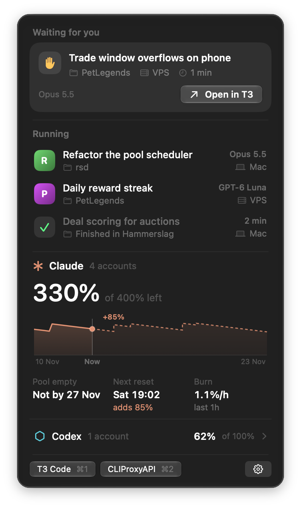
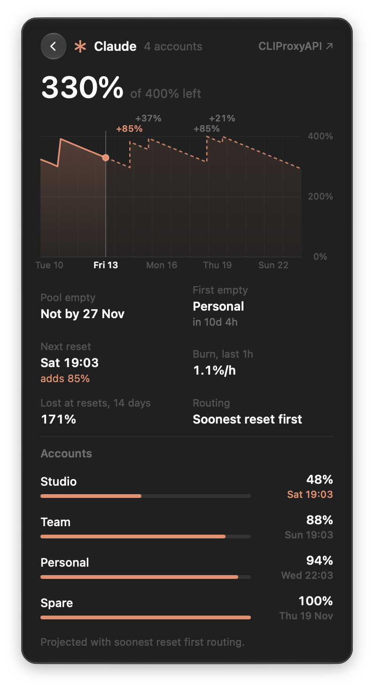

<h1 align="center">Pulse</h1>

<p align="center">
  Your agents and your quota, one glance away in the menubar.<br>
  A tiny native macOS app for <b>T3 Code</b> and <b>CLIProxyAPI</b>.
</p>

<p align="center">
  
  &nbsp;&nbsp;
  
</p>

## What it shows

- **The ring.** Your quota pool, filled with what's left. The center turns solid while threads run, an orange badge appears when one is waiting for you, and the ring turns red when the pool runs low.
- **The panel.** Threads waiting for you, running threads and recently finished ones on every linked machine, plus a burn-down chart of the pool. Click any thread to open it in T3 Code.
- **The forecast.** Click the chart for 14 days of history and projection, reset jumps, when the pool or the first account runs dry, and each account's level.
- **Notifications.** A thread is waiting for you, a thread finishes, or the pool drops under your threshold.

## Install

```sh
git clone git@github.com:HLVM04/Pulse.git && cd Pulse
scripts/build-app.sh --install
```

This builds a release version, signs it with your Apple Development identity (or ad hoc if there isn't one), copies it to `/Applications` and launches it. Requires macOS 26 and Xcode 26 or later.

## Set up

1. **CLIProxyAPI.** Open Settings (gear icon), enter the server address and the management key. The key is stored in the Keychain.
2. **T3 Code.** Click **Connect…** and approve Pulse in the browser. It asks for read-only access, and T3's sign-in lasts 30 days.

## How it works

| | Source | Refresh |
|---|---|---|
| Quota pool | CLIProxyAPI `GET /v8/management/observability/quota` | every minute |
| Threads | T3 Code MCP: `t3_thread_list`, `t3_project_list`, `t3_environment_links` | every 4 s while open, 15 s otherwise |

The forecast in [`PoolMath.swift`](Sources/PulseCore/PoolMath.swift) is a line-for-line port of the CLIProxyAPI management center's `poolModel.ts`, so Pulse and the web page agree. T3's MCP can't approve permission requests, so a waiting thread opens in T3 instead of being approved from the panel.

There are no dependencies: SwiftUI, Network and CryptoKit only. The app bundle is about 1.6 MB.

## Develop

```sh
swift test                                    # pool math and parsing
open -n --env PULSE_DEMO=1 /Applications/Pulse.app   # made-up data, for screenshots
PULSE_SNAPSHOT=/tmp/pulse /Applications/Pulse.app/Contents/MacOS/Pulse   # render the panel to PNGs
```

Compare the forecast with your server:

```sh
PULSE_CPA_URL=https://your-host:8317 PULSE_CPA_KEY_FILE=~/key.txt swift test --filter liveQuotaPools
```
